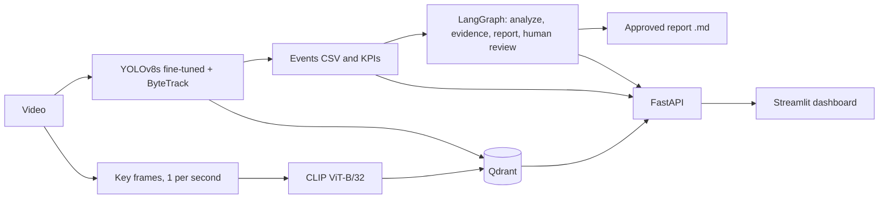

# VisionAgent: construction-site safety with vision, search and agents

Video analysis pipeline: **YOLOv8 detection and tracking, events and KPIs, semantic search (CLIP + Qdrant), a LangGraph report workflow with human validation, served by FastAPI and Streamlit in Docker Compose.**


## What it does

1. Detects helmets, bare heads (no helmet) and vests in site videos, and tracks them over time.
2. Turns detections into events (one row per tracked object) and computes KPIs and time series.
3. Lets you search the archive in natural language, combined with detector facts (hybrid search).
4. Generates a safety report with a LangGraph workflow that **pauses for human approval** before saving.
5. Exposes everything through an API and a dashboard.

## Architecture



## Run it

Requirements: Docker Desktop, and Python 3.11 or newer for the indexing step.

```bash
pip install -r requirements.txt

# put site videos in data/ (for example data/test.mp4), then:
python detection/pipeline.py test            # events per video
python detection/10_extract_all_frames.py    # key frames, 1 per second

docker compose up -d qdrant
# Windows PowerShell:  $env:QDRANT_URL="http://localhost:6333"
# Linux / macOS:       export QDRANT_URL=http://localhost:6333
python detection/11_index_frames.py pad

docker compose up --build
```

Dashboard: http://localhost:8501 (API docs: http://localhost:8000/docs)

## Project structure

```
detection/   detection, tracking, events, key frames, indexing
agents/      LangGraph report workflow with human validation
api/         FastAPI service
dashboard/   Streamlit app
models/      fine-tuned weights (best.pt)
results/     metrics notes, figures, reports
```

*(Results and limitations: coming in part 2.)*