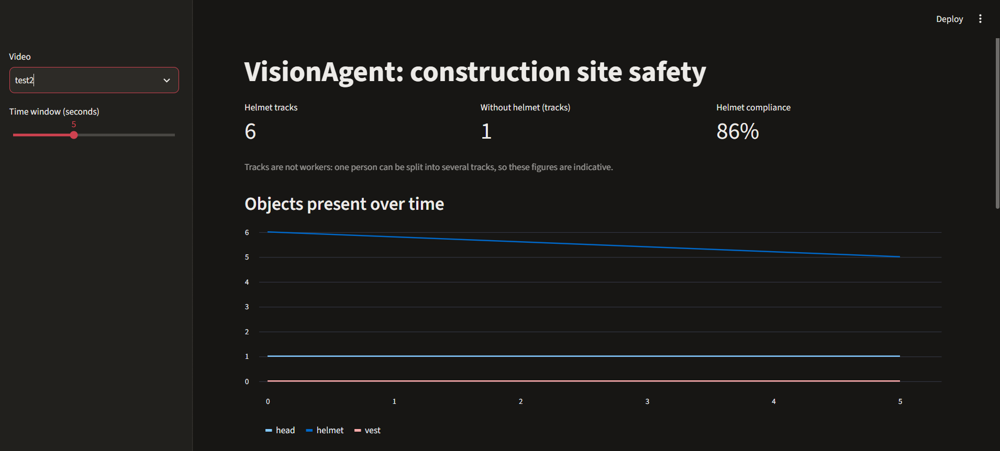
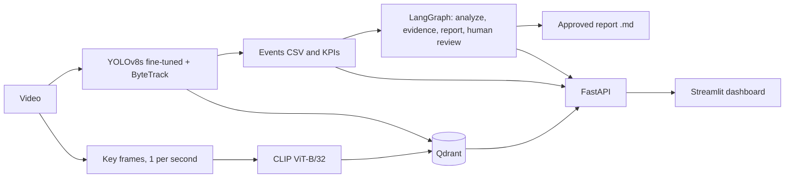

# VisionAgent: construction-site safety with vision, search and agents

Video analysis pipeline: **YOLOv8 detection and tracking, events and KPIs, semantic search (CLIP + Qdrant), a LangGraph report workflow with human validation, served by FastAPI and Streamlit in Docker Compose.**



## What it does

1. Detects helmets, bare heads (no helmet) and vests in site videos, and tracks them over time.
2. Turns detections into events (one row per tracked object) and computes KPIs and time series.
3. Lets you search the archive in natural language, combined with detector facts (hybrid search).
4. Generates a safety report with a LangGraph workflow that **pauses for human approval** before saving.
5. Exposes everything through an API and a dashboard.

## Architecture



## Run it

Requirements: Docker Desktop, and Python 3.11 or newer for the indexing step.

```bash
pip install -r requirements.txt

# put site videos in data/ (for example data/test.mp4), then:
python detection/pipeline.py test            # events per video
python detection/10_extract_all_frames.py    # key frames, 1 per second

docker compose up -d qdrant
# Windows PowerShell:  $env:QDRANT_URL="http://localhost:6333"
# Linux / macOS:       export QDRANT_URL=http://localhost:6333
python detection/11_index_frames.py pad

docker compose up --build
```

Dashboard: http://localhost:8501 (API docs: http://localhost:8000/docs)

## Project structure

```
detection/   detection, tracking, events, key frames, indexing
agents/      LangGraph report workflow with human validation
api/         FastAPI service
dashboard/   Streamlit app
models/      fine-tuned weights (best.pt)
results/     metrics notes, figures, reports
```

## Results

### Detection: YOLOv8s fine-tuned, held-out test set

Dataset: "hat vest" by Mirass Workspace, from Roboflow Universe, license CC BY 4.0. 2,072 train / 259 validation / 259 test images, 3 classes. Training: 50 epochs, image size 640, batch 16, Colab T4 GPU, 31 minutes.

| Class | Precision | Recall | mAP50 | mAP50-95 | Test instances |
|---|---|---|---|---|---|
| **all** | 0.880 | 0.798 | **0.870** | **0.509** | 2,415 |
| head (no helmet) | 0.944 | 0.897 | 0.950 | 0.478 | 1,734 |
| helmet | 0.873 | 0.857 | 0.905 | 0.573 | 578 |
| vest | 0.822 | 0.641 | 0.756 | 0.476 | 103 |

Inference: about 11 ms per image on a T4 GPU. The test score is slightly above the validation score (mAP50 0.870 vs 0.856), so there is no sign of overfitting to the validation set.

### Inference resolution

The model was trained at 640 pixels and evaluated at two inference sizes on the same test set.

| Image size | mAP50 | mAP50-95 | vest mAP50 | ms per image (T4) |
|---|---|---|---|---|
| 640 | 0.870 | 0.509 | 0.756 | 11.3 |
| 1280 | 0.750 | 0.412 | 0.485 | 45.5 |

Raising the resolution only at inference lowered every metric and made inference 4 times slower. The model needs to be retrained at the higher resolution. On the site video, 1280 did reveal distant vests missed at 640, so the gain exists where objects are small, but this is not measured.

### Tracking and events

- `test.mp4`: 126 raw tracks, of which 44 last at least 1 second (26 helmet, 18 vest). The 82 short tracks are noise or fragments and are filtered out.
- `test2.mp4`: 6 helmet tracks and 1 `head` track, so a track-level helmet compliance of 86%. The `head` track was checked by hand: a true positive, a worker wearing a cap.
- Tracks are not workers. One person can be split into several tracks, so these percentages are indicative only.

### Vision-language model: Qwen2-VL-2B, 5 key frames, qualitative

| Approach | Finding |
|---|---|
| Whole-scene JSON answer | Counts 5 workers instead of 7, flags a white helmet as a violation, and loops when asked to list everyone |
| Detector counts injected in the prompt | Inherits the detector's errors and invents hazards that are not in the image |
| One crop per person | Helmet versus cap is correct, but the model always answers "vest: yes" and invents colors |

Decision: the detector produces the safety events. A 2B vision-language model cannot reliably confirm that something is absent, so it is not used for compliance checks.

### Semantic search: CLIP ViT-B/32 and Qdrant, 31 frames

- Scene and object queries work: "a yellow metal container" and "stacked grey concrete blocks" each returned 5 of 5 frames from the right video.
- - Action and detail queries ("a worker sitting on a chair", "a person talking on the phone") returned flat, low similarity scores and mostly irrelevant, near-duplicate frames from the same moment of `test.mp4`; none of the `test2` frames showing a seated worker or a phone call were retrieved.
- Negation fails: "a worker without a helmet" returned 2 of 5 frames with a bare head when using CLIP alone. Filtering on the detector fact `head > 0` returns 5 of 5, which is why the search is hybrid.

## Known limitations

- The vest class is weak (recall 0.641 on only 103 test instances), and the detector misses non-yellow vests. A more varied vest dataset is needed.
- Many `head` training images are classroom scenes, not construction sites, which inflates the `head` score.
- Small, distant workers are missed when a 4K frame is resized to 640 pixels.
- Only two demo videos were processed, so the video-level numbers are illustrations, not statistics.
- Reports are generated from a template, with no language model. Pending reports are kept in memory and are lost if the API restarts.

## Next steps

Retrain at a higher resolution and with a more varied vest dataset; compare YOLOv8n and YOLOv8s and an FP16 or ONNX export; add an LLM-written report narrative and PDF export; evaluate the faithfulness of generated reports.

## License and credits

- Dataset: "hat vest" by Mirass Workspace, Roboflow Universe, CC BY 4.0.
- YOLOv8 is provided by Ultralytics under the AGPL-3.0 license. Check its terms before any commercial reuse.