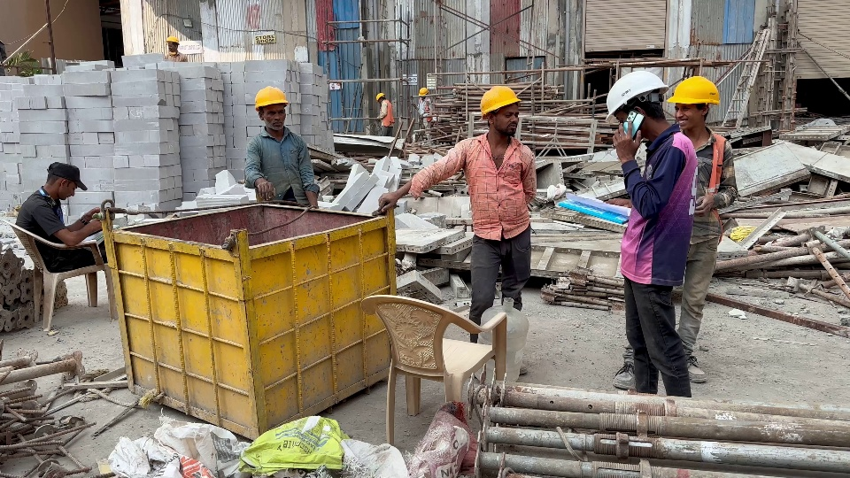

# Safety report: test2

## Summary
- helmet: 6 stable tracks
- head: 1 stable tracks
- Helmet compliance (track level): 86%

## Violations (worker without helmet)
- Track 4: 0.0s to 7.8s (7.8s), mean confidence 0.73

## Key frames (hybrid search)

## Limitations
- Tracks are not workers: one person can be split into several tracks.
- Vests are not verified (detector misses non-yellow vests).
- Few tracks: percentages are indicative only.
- Violations need human review (context matters).